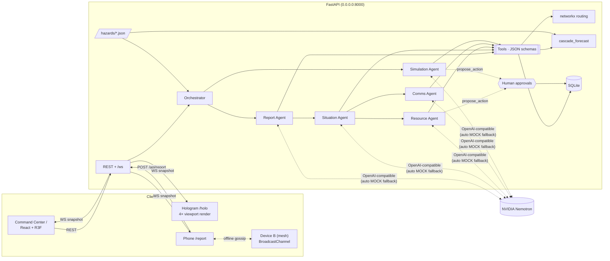

# HoloSafe

**See. Understand. Evacuate. Coordinate.**

AI-powered, infrastructure-independent emergency coordination with a holographic 3D command center.

HoloSafe uses interactive 3D holographic environments, leveraging AI agents and mesh networks to track occupants, detect hazards, and coordinate real-time evacuation and rescue operations.
Hackathon prototype for HackUTD, Nemotron track. Five NVIDIA Nemotron tool-calling agents coordinate evacuation, rescue and
fallout forecasting over one live world model. That model is rendered on a laptop and as a Pepper's Ghost hologram.

---

## Quick start

```bash
# one-time setup (Python 3.11+ and Node 20+)
npm run setup          # creates backend/.venv, installs Python + npm deps
cp .env.example .env   # then fill NEMOTRON_API_KEY / NEMOTRON_MODEL (see below)

# run everything (FastAPI :8000 + Vite :5173)
npm run dev
```

On startup the backend prints the LAN URLs:

| Display | URL | Where |
|---|---|---|
| Command Center | `http://localhost:5173/` | laptop |
| Hologram | `http://localhost:5173/holo` | second monitor, fullscreen (`f`), under the pyramid |
| Civilian report | `http://<LAN-IP>:5173/report` | any phone on the same Wi-Fi |

Vite proxies `/api` and `/ws` to FastAPI, so the phone only needs the one `:5173` URL. Both servers bind to `0.0.0.0`.
If the phone can't connect, allow incoming connections for Node/Python in the macOS firewall.

`npm run reset` reloads the seed from the CLI. The **↺ Reset** button does the same thing from the UI.

### Nemotron configuration (`.env`)

```
NEMOTRON_API_KEY=nvapi-...
NEMOTRON_BASE_URL=https://integrate.api.nvidia.com/v1
NEMOTRON_MODEL=nvidia/llama-3.3-nemotron-super-49b-v1   # any tool-calling Nemotron model
AGENT_MODE=live        # live = Nemotron with automatic MOCK fallback · mock = deterministic only
AGENT_TIMEOUT=20       # seconds before a live agent call falls back to MOCK
```

With no key, or `AGENT_MODE=mock`, every agent runs its deterministic MOCK workflow. The header badge shows
`MOCK · <reason>` or `NEMOTRON LIVE`. Every Agent Activity entry is tagged `NEMOTRON` or `MOCK`.

---

## Demo script

Click **◈ Demo** in the header for a step-by-step walkthrough. Each step has **Next** plus ▶ action buttons, in case you'd rather not click around live.

1. Intact 3D city in the hologram.
2. **Trigger** earthquake (`hazards/earthquake.json`).
3. Distress reports stream in (phones, a wearable fall beacon, traffic cams).
4. Agents triage in the Agent Activity panel. The isolated critical person (single low-confidence beacon) ranks **#1**; the lobby with 4 reports ranks last (*volume ignored*).
5. Independent people get green evacuation routes. Unknown-mobility people are flagged **NEEDS ASSESSMENT** and not routed.
6. Trapped and critical people enter the rescue queue. Magenta responder routes are proposed; **Approve** in the queue and the responder drives the route.
7. On the phone (`/report`): *Blocked route → Meridian Tower → floor 2 → Stairwell 1 → "Stairwell 1 blocked by debris"* (pre-filled).
8. The edge turns amber dashed (`reported_blocked`) and 9 people re-route to Stairwell 2 in both views. A **Verify blocked** approval appears.
9. Forecast slider **NOW / +1H / +6H / +24H**: violet volumes for predicted effects, each with a precaution and deadline. **Approve** "Shut gas main valve" and the fire forecasts flip to AVERTED.
10. **⦸ Offline**: agents switch to MOCK, messages queue, and reports from `/report` or **⌬ Device B** relay peer-to-peer and show as QUEUED. **⟲ Reconnect** syncs them with an animation.

Bonus: select **⌁ cyber** → **▶ Trigger**. The same five agents run. Failure spreads along `infra_deps` and the shared vendor
(VoltNet SCADA), not geography. Dependency arcs light up, and backup hours decide *when* each dependent fails.

Clicking a building (or the top buttons) isolates it, and **FLOOR ▲▼** steps through its floors. Clicking a triage card jumps to it. The hologram follows the
Command Center's building focus and time horizon, because both are shared view state.

---

## Hologram calibration (`/holo`)

The same scene renders 4× in a cross: top, bottom, left and right, each image's top pointing outward. All four come from one WebGL context with four
scissored square viewports and four cameras 90° apart. There's no UI chrome. Settings persist in `localStorage`.

| Key | Action |
|---|---|
| `+` / `-` | view size (hold **Shift** for ×5 steps) |
| `[` / `]` | gap between the centre and each view |
| arrow keys | move the cross centre |
| `,` / `.` | zoom out / in |
| `r` | auto-rotate on/off |
| `m` | mirror (if the reflection reads reversed) |
| `g` | centre/gap guide overlay |
| `f` | fullscreen |
| `0` | reset calibration |
| `h` / `?` | help overlay |

---

## Architecture



**Architecture rules held throughout**

1. The 3D scene renders only structured backend state. Agents never produce visuals.
2. The LLM never invents routes, zones or forecasts. It calls `route`, `spatial_lookup` and `cascade_forecast` and reasons over the results.
3. High-impact actions (dispatch, verify-blocked, declare-safe, operational precautions) wait in the **human approval queue**. Only approved actions change state.
4. Every agent has a deterministic MOCK path. Live calls fall back to it automatically on API error, timeout, or when the model skips a required tool call.
5. Disaster types are config files. Adding a hazard means adding `backend/hazards/<name>.json` (effects, reports, triage weights, cascade rules, precaution templates).
6. Uncertainty is visible. Incidents carry confidence, timestamp and source. Unknown edges are dim grey and never "safe". Shelters stay *UNVERIFIED* until approved. Predicted effects are violet translucent volumes, distinct from confirmed hazards.

### Agents (one Nemotron client, five workflows)

| Agent | Pathway | Tools | What it does |
|---|---|---|---|
| **Report** | ingest | `spatial_lookup`, `create_incident`, `update_edge_status` | Classifies the raw report, extracts the location (e.g. "room 305" → node), sets severity and confidence, dedupes. Civilians can only *report* a blockage. |
| **Situation** | world state | `rank_incidents`, `create_incident`, `propose_action` | Flags unknown mobility → needs assessment, flags assisted evacuations, proposes shelter verification and blockage verification, then ranks by severity · isolation · vulnerability · time · accessibility · confidence (not volume). |
| **Resource** | B: rescue | `route(mode=responder)`, `propose_action` | Matches responders to the top trapped and critical incidents (kind-aware), computes access routes (may force a verified blockage), and proposes dispatches. |
| **Comms** | A: evacuation | `route(mode=civilian)`, `notify` | Issues per-person routes and messages, re-routes anyone whose path crosses a new blockage, keeps civilians off the Central Ave responder corridor, and queues messages when offline. |
| **Simulation** | fallout | `cascade_forecast`, `propose_action` | Runs the deterministic cascade at +1/+6/+24h, writes a plain-language explanation and a precaution with a deadline for each forecast (strict JSON), and sends operational precautions to approval. |

Event flow: *new report* → Report → Situation → (Resource ∥ Comms). *Scenario start* or a hazard report → Simulation.
Every step goes to `agent_log` and streams over the WebSocket.

### Routing (`backend/app/routing.py`)

Dijkstra over the building and street graph (147 nodes, 158 edges):

- `reported_blocked` and `verified_blocked` edges are excluded for civilians.
- `unknown` edges cost ×40, so they're used only when there's no alternative, and are flagged.
- `needs_assist` people pay ×6 on non-accessible edges (stairs, the stepped west exit).
- Civilians pay ×60 on reserved responder corridors; responders get a discount there.
- Responders may pass reported blockages (×4) and force verified ones (×10, flagged "forced entry").

### Cascade (`backend/app/cascade.py`)

- **Infrastructure:** earliest-failure propagation over `infra_deps`. A dependent fails at `supplier_fail + delay + backup_hours`. Confidence decays per hop.
- **Earthquake:** an Omori-style aftershock probability `p0·e^(−h/τ)` with a shrinking radius; buildings with critical damage or near the epicentre become *weakened*; a damaged gas main means ignition at +1h, then spread 1 and 2 street hops at +6h and +24h.
- **Cyberattack:** infra sharing the target's vendor or network is a *compromise risk* at +6h, and its dependents cascade from there. Approving *isolate network* averts the whole chain.

---

## Project layout

```
backend/
  app/main.py          FastAPI routes + /ws
  app/orchestrator.py  event flow, approvals executor, responder movement
  app/agents.py        Nemotron client, run/fallback/log harness, 5 agents
  app/tools.py         8 tools + JSON schemas
  app/routing.py       networkx routing
  app/cascade.py       cascade_forecast
  app/scenario.py      hazard config loader / T+0 effects
  app/state.py         snapshot + WebSocket broadcast
  hazards/*.json       earthquake, cyberattack
  seed/seed.py         city, people, responders, infra graph
frontend/src/
  pages/               CommandCenter, Holo, Report
  scene/CityScene.tsx  the single 3D scene (shared by both displays)
  components/          panels, demo, splash, offline/mesh
  lib/                 store (zustand), ws (+IndexedDB cache), outbox (queue + mesh)
frontend/public/logo.svg   placeholder. Drop in logo.png/.webp/.jpg and it's picked up automatically.
```

---

## Choices & shortcuts (judges, read this)

- **Python 3.13** is used locally (3.11 wasn't installed). The code is plain 3.11-compatible.
- **Agents are hybrid workflows.** Where an agent must act on many entities (Comms routing 20 people, Situation flagging vulnerable people), those tool calls run as deterministic *pre-steps* (still real, logged tool calls). The LLM then reasons, writes broadcasts and explanations, and calls the remaining tools. This keeps live latency bounded and the demo reliable. The Report and Resource agents are fully LLM tool-calling in live mode.
- **The live path was exercised against a local fake OpenAI-compatible server**, not real Nemotron (no key during the build). Covered: tool-call loop, `<think>` stripping, validation fallback, timeout/connection fallback. Some Nemotron models need `detailed thinking off`, which is prepended automatically for model names containing "nemotron".
- **"Offline" is simulated.** A backend flag forces MOCK mode and queues messages. Phones see the flag over the still-open socket and queue locally. If the backend itself dies, the UI keeps rendering the last snapshot from IndexedDB with a *LINK LOST · CACHED* banner. The mesh is `BroadcastChannel`, so it works between tabs of the **same browser** (the Command Center's Device B panel plus `/report` tabs), not between separate phones.
- **Sync is idempotent.** Each queued report keeps its client id, and the server ignores duplicates, so it's harmless if both devices flush the same relayed report.
- **The simulation is horizon-based, not a clock.** Responders animate along their route (~0.5 s per node), then the person is marked rescued. People don't walk their evacuation routes; routes are shown, not simulated.
- **Labels** are a DOM overlay projected each frame (drei `<Html>` threw unmount warnings under React 19). The hologram has no labels.
- React `StrictMode` is off, to keep the console clean with R3F.
- Fonts come from Google Fonts (Orbitron / Chakra Petch / Share Tech Mono). Fully offline, the UI falls back to system fonts.
